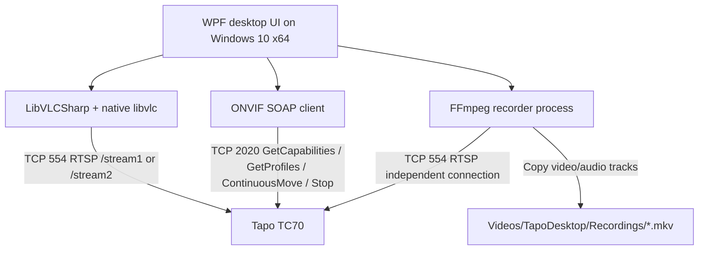

# Architecture and roadmap

## Diagram

The recorder establishes an additional RTSP session rather than reading frames from LibVLC. This isolates recording from the live view. Some camera firmware has session/stream restrictions, so concurrency must be tested.

## Components

- `MainWindow.xaml` / `.cs`: interface, stream selection, in-memory session settings, basic event handlers.
- `OnvifPtzClient.cs`: WS-UsernameToken Digest + SOAP 1.2, GetCapabilities/GetProfiles, movement pulses with an explicit Stop and short timeout.
- `FfmpegRecorder.cs`: spawn FFmpeg, stream copy to MKV, send `q` for graceful termination, force-kill after timeout.
- `build.ps1`: Windows self-contained publish.
- `installer/TapoDesktop.iss`: unpack publish folder into Programs and create shortcuts.

## Compatibility

| Property | TC70 |
|---|---|
| Power | Mains powered Wi-Fi camera |
| Video | Up to 1080p, H.264 |
| RTSP | Officially specified yes, local TCP port 554 |
| ONVIF | Officially specified yes, local service port 2020 |
| PTZ | Pan range 340 mechanical degrees, tilt 70 mechanical degrees |
| Hardware optical zoom | Not documented; omit from MVP |
| Cloud archives and two-way audio via ONVIF | Not assumed supported |

TC70 revision/firmware and its enabled ONVIF PTZ profile must be checked with the physical camera. The minimal SOAP client uses Media1 and a common WS-Security UsernameToken flow but does not implement ONVIF GetServices, WS-Discovery, every PTZ velocity space, digest timing retries, TLS, or alternate authentication schemes.

## Phase roadmap

1. **Milestone A — Video:** Validate the Tapo Camera Account, RTSP high/low feed, video reconnect and graceful disposal.
2. **Milestone B — Movement:** Confirm Media1 GetProfiles + PTZ service endpoints; query PTZ limits/space on TC70 firmware and adapt move speed/polarity.
3. **Milestone C — Recording:** Verify separate RTSP recording, audio track mapping, finalization, recorder process status, file durations and disk exhaustion handling.
4. **Milestone D — Windows distribution:** Validate clean-machine x64 install/uninstall and FFmpeg licensing/redistribution, sign installer, add diagnostics.
5. **Milestone E — Production:** Credential storage via DPAPI opt-in, multiple camera profiles, ONVIF WS-Discovery, snapshots, recording scheduler, segmenting, disk retention, automated tests.

## Non-goals

No Tapo APK unpacking, private-cloud protocol replication, remote-port exposure, firmware exploitation, or rebranding as an official TP-Link client. This app is a separate protocol-based prototype.
